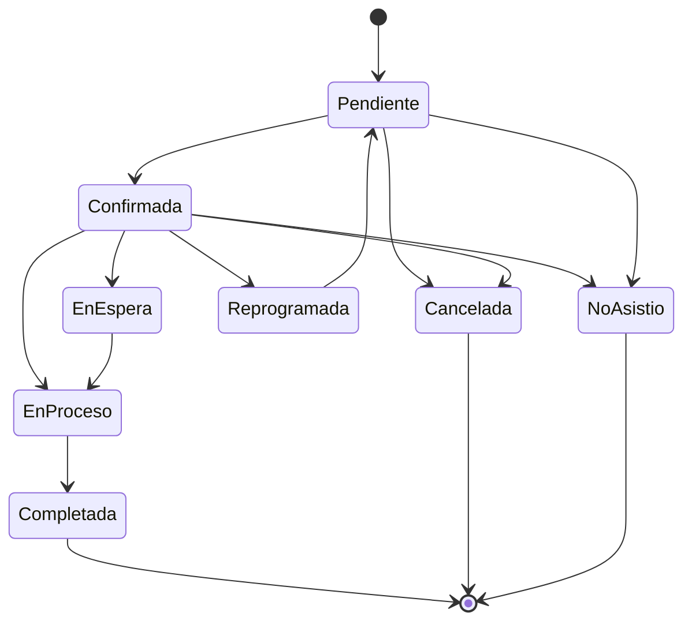

# Diseño del motor de reservas

Vive en `backend/apps/appointments/`, separado de las vistas: recibe una solicitud de reserva ya validada de forma superficial (datos bien formados) y aplica las reglas de negocio antes de decidir si crea la `Appointment`. Es el único punto de escritura de citas — tanto la UI del staff, como la reserva online pública, como la API pública de integración, pasan por el mismo caso de uso.

## Validaciones, en orden

1. **Cliente válido** — el `customer_id` existe y pertenece a la organización del contexto (tenant).
2. **Servicio válido** — el `service_id` existe, pertenece a la organización, y está `active`.
3. **Profesional disponible** — el `employee_id` (si se especifica) puede prestar ese `service_id` (relación `EmployeeService`) y está activo.
4. **Sucursal** — el `branch_id` ofrece ese servicio (`ServiceBranch`) y el empleado pertenece/opera en esa sucursal.
5. **Horario permitido** — el rango `(start_time, end_time)` solicitado cae dentro del horario laboral vigente de sucursal y empleado (`Schedule`), y no cae en un descanso ni en un `AvailabilityBlock` (vacaciones, feriado, bloqueo manual).
6. **Sin conflicto** — no existe otra `Appointment` del mismo empleado que se solape con el rango solicitado, entre los estados que ocupan agenda (`pending, confirmed, waiting, in_progress`).
7. **Duración correcta** — `end_time - start_time` coincide con `duration_minutes` del servicio (o el override permitido explícitamente).
8. **Estado inicial válido** — la cita nueva solo puede nacer en `pending` o `confirmed` (según si requiere confirmación manual o no, configurable por organización); no se crea directamente en otros estados.

Solo si las 8 validaciones pasan, se persiste la `Appointment`. Cualquier falla lanza una excepción de dominio específica (`ConflictError` para solapamiento, `ValidationError` para el resto) mapeada al formato de error uniforme (`docs/error-handling.md`).

## Estrategia de concurrencia (anti doble-reserva)

El riesgo: dos requests casi simultáneas intentan reservar el mismo `(employee_id, fecha, horario)`. Defensa en dos capas:

1. **Aplicación:** dentro de una transacción de base de datos, se hace `SELECT ... FOR UPDATE` (bloqueo pesimista de fila) sobre las citas activas del empleado en la fecha solicitada antes de re-validar el paso 6 (sin conflicto), justo antes del `INSERT`. Esto serializa las reservas concurrentes para el mismo empleado/fecha.
2. **Base de datos (defensa en profundidad):** un constraint de exclusión de PostgreSQL (`EXCLUDE USING gist` sobre `employee_id` + rango `tsrange(fecha+start_time, fecha+end_time)`, filtrado a estados activos) o, si se prefiere algo más simple de mantener, un índice único parcial sobre `(employee_id, appointment_date, start_time)` para los estados activos. Si dos transacciones concurrentes evaden el lock de aplicación por cualquier razón, la base de datos rechaza el `INSERT` duplicado con un error de integridad, que la capa de servicio traduce a `ConflictError` (HTTP 409).

Con estas dos capas, incluso ante múltiples workers/procesos del backend, no puede persistirse una doble reserva — se verifica con un test de concurrencia real (dos requests lanzadas en paralelo contra el mismo slot) en la Fase 5.

## Estados de la cita y transiciones válidas

- Cada transición pasa por el motor de reservas (no se permite `PATCH` directo de `status`), se valida contra esta máquina de estados, y se registra en `AuditLog` (quién, cuándo, de qué estado a cuál, motivo si aplica).
- **Reprogramar** internamente es: liberar el slot anterior (marcar `Reprogramada` el registro viejo o mover sus horarios) + re-ejecutar el flujo de validación completo sobre el nuevo horario — nunca se asume que el nuevo horario es válido solo porque el anterior lo era.
- **Cancelar** no borra la cita (soft: cambia estado), preservando el historial para reportes y auditoría.

## Independencia de la UI

El caso de uso `CreateAppointmentUseCase` (o equivalente) recibe un DTO simple (ids + fechas/horas + canal de reserva) y devuelve la entidad creada o lanza una excepción de dominio. Las vistas DRF (interna y pública) y cualquier tarea de Celery que cree citas (p. ej. importaciones) son clientes delgados de este único caso de uso — así se garantiza que las reglas 1-8 y el locking se aplican siempre, sin importar el canal de entrada.
