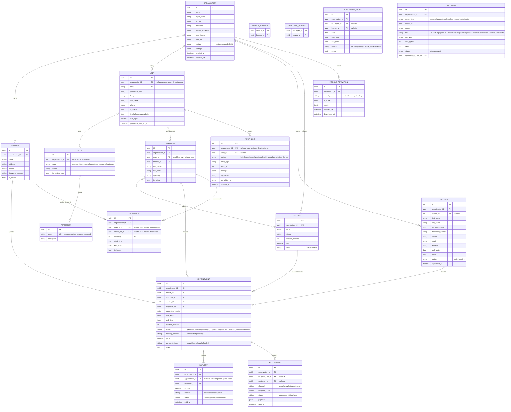
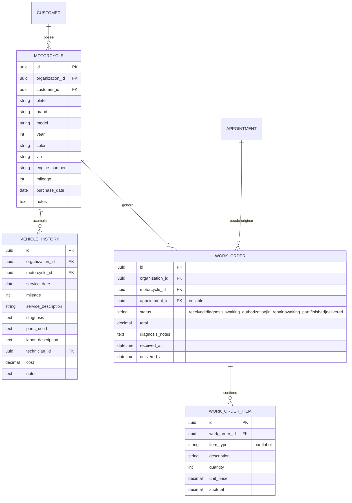
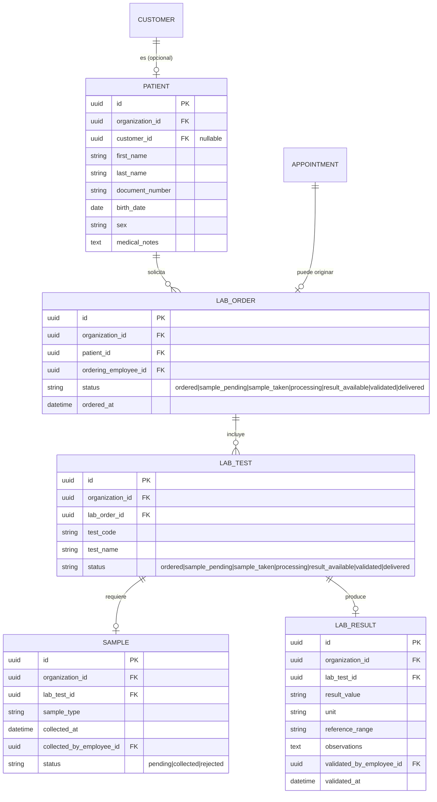
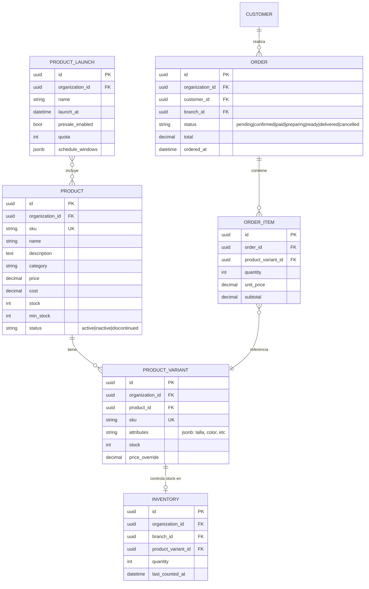
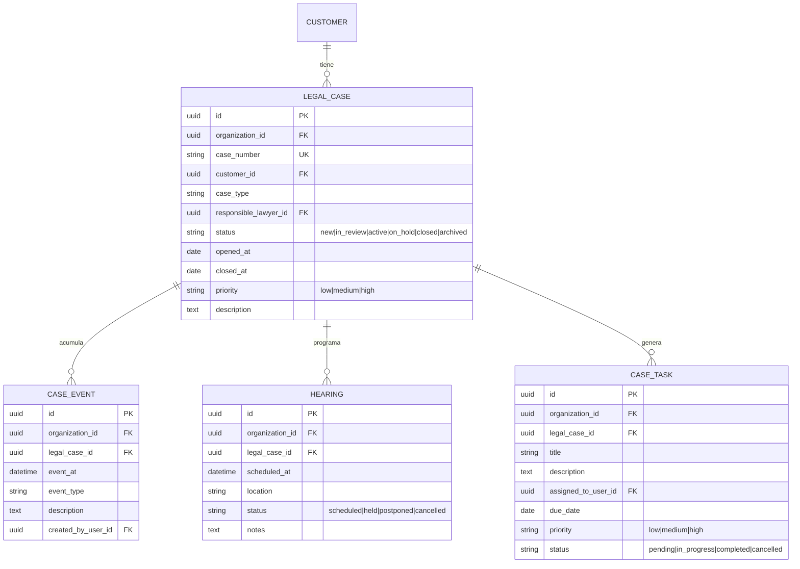

# Modelo de datos (ERD)

Todas las entidades marcadas `[tenant]` heredan de `TenantAwareModel` (FK obligatoria `organization_id`, no anulable, indexada). Todas las entidades heredan además de `TimeStampedModel` (`created_at`, `updated_at`) salvo que se indique lo contrario. `SoftDeleteModel` se usa donde se indica `[soft-delete]`.

## Core

**Restricciones e índices clave del core:**

- `USER.email` único global (o único por `organization_id` si se permite el mismo email en distintas organizaciones — decisión: único global para simplificar login).
- `APPOINTMENT`: índice compuesto `(organization_id, branch_id, employee_id, appointment_date)` para acelerar el cálculo de disponibilidad; constraint de exclusión (`EXCLUDE USING gist`) o único parcial sobre `(employee_id, appointment_date, start_time, end_time)` para estados activos (`pending, confirmed, waiting, in_progress`), como defensa a nivel de base de datos contra doble reserva (ver `docs/booking-engine.md`).
- `MODULE_ACTIVATION`: único `(organization_id, module_code)`.
- `DOCUMENT`: índice `(organization_id, owner_type, owner_id)`.
- `AUDIT_LOG`: sin `updated_at`, sin soft-delete, sin permiso de `DELETE` a nivel de aplicación (ni siquiera para superadmin de organización).

## Módulo Taller de motos (`moto`) `[tenant]`

## Módulo Laboratorio clínico (`laboratory`) `[tenant]`

**Nota de sensibilidad:** `PATIENT`, `LAB_RESULT` y `SAMPLE` requieren control de acceso reforzado (ver `docs/auth-rbac.md` y `docs/security-iso27001.md`); todo acceso de lectura/escritura a `LAB_RESULT` queda auditado.

## Módulo Tienda / lanzamientos (`store`) `[tenant]`

## Módulo Legal (`legal`) `[tenant]`

## Tabla genérica de tareas transversales (Fase 11B)

`TASK` (distinta de `CASE_TASK`, reutilizable por cualquier módulo): `organization_id`, `owner_type` (`customer|appointment|case|work_order|order`), `owner_id`, `title`, `description`, `assigned_to_user_id`, `due_date`, `priority`, `status`.
